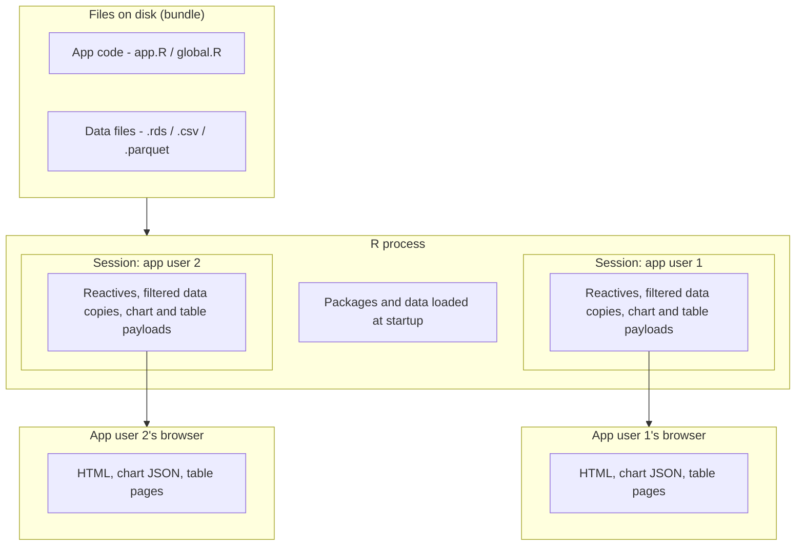

# How Shiny apps use memory: a practical guide for analysts

**Audience:** analysts and those who build and maintain Shiny apps. No web or software engineering background is assumed.

**How to read:** read [part 1](#part-1---what-is-actually-running-when-someone-opens-a-shiny-app) first for the mental model of how Shiny apps operate. Then, [part 2](#part-2---improving-memory-use) is a worked example that starts with the heaviest way to build an app and improves it one step at a time, easiest and biggest wins first. Each step says what to change, why it matters, and what to expect. [Part 3](#part-3---measuring-performance) covers measuring performance, and [part 4](#part-4---checklist) is a checklist to keep beside you when you deploy.

## Part 1 - what is actually running when someone opens a Shiny app?

When you click "Run App" in RStudio, or run `shiny::runApp()`, R reads your `app.R` and starts a small web server. This runs locally, either on your computer or Posit Workbench session. Something similar happens when the app is deployed on shinyapps.io or Posit Connect, except that the R process runs on the server you deployed to. This stays running and is designed to serve many people at once. Understanding memory comes down to knowing which parts of your code run **once per R process** and which parts run **once per user**.



### Three places Shiny code runs

| Where the code lives | Runs | Memory location | Typical contents |
| --- | --- | --- | --- |
| Top level of `app.R`, or `global.R` / `setup.R` | Once, when the process starts | Shared by every session in that process | `library()` calls, `readRDS()`, lookup lists, helper functions |
| Inside `server <- function(input, output, session) { ... }` | Once **per user** who opens the app | Unique to that user's session, freed when they leave | `reactive()`, `render*()`, `observe()` |
| Inside a `reactive()` or `render*()` | Every time an input it depends on changes | Result kept until the next change | filtering, joining, building charts |

A common problem with memory can often be tracked down to using `readRDS()` or `read_csv()` inside the `server()`. This means that every user who opens the app loads their own unique copy of the data, into their session and browser. Instead, by using a top-level `readRDS()`, the data is loaded once per process and can be shared across all sessions on that process.

### What takes up memory

In rough order of size for a typical Shiny app:

1. **Data loaded at startup.** A data frame in R is much larger than its file on disk. `.rds` files are compressed, so a 3 MB file can easily be 150 MB or more once loaded. See "Estimating size" in [part 3](#part-3---measuring-performance).
2. **Packages.** Shiny, plotly, dplyr, DT and all the usual suspects add to roughly 200 MB. This is a fixed cost per process which can be trimmed, but not removed. A good first step is to remove any packages that are not used in the app, and avoid loading packages that are suites of many sub-packages, e.g. phsverse, tidyverse or tidymodels. Instead, load only the packages you need, like phsstyles, dplyr, or broom.
3. **Per-session working copies.** Each dplyr verb, like `filter()`, `select()`, `arrange()` or `mutate()` makes a new object, and Shiny reactives hold onto their latest result for as long as the session lives.
4. **Intermediate/transient allocations during processing.** Filtering a large table with several conditions creates a temporary logical vector (one `TRUE`/`FALSE` per row) for each condition, plus other space to accommodate intermediate computations and results. This memory is freed afterwards, but the process has to have the resources available for the peak.
5. **Chart and table payloads.** A plotly chart holds every point it draws as JSON, on the server while building and in the browser afterwards. A DT table with server-side processing keeps a copy of its data in the session and sends row indices back and forth on every page change.

### Two things about R that catch people out

- **Copies are cheap until you modify.** R shares memory between objects that are identical, so `b <- a` costs nothing. As soon as you change `b`, R makes a full copy. Most dplyr verbs produce a new object, so a chain of five verbs on a large table can briefly hold several copies.
- **Freed memory often stays with the process.** When R finishes with an object, there is a process that tidies up the leftover things in memory, called the garbage collector. Garbage collection runs to release unused memory for R to use again for the next process. However, the system running the process may not get it back quickly or properly. The memory usage on the hosting platform therefore tends to show the *peak* a process has reached, not what it is using right now. An app that spikes once can stay "big" until the process restarts. This makes avoiding peaks more valuable than cleaning up after them.

### What the hosting platform adds

Both shinyapps.io and Posit Connect run your app in one or more R processes ("workers") on a machine with a fixed memory budget. The default allocation is three workers on a 1 GB instance, which is enough for many apps. However, increasing dataset size and complexity can strain this budget, so increasing the instance size or reducing the number of workers may be necessary. The platform's memory metrics show the total memory used by all workers together, and the log shows when a worker is "killed" (terminated) for exceeding its limit.

- **Every worker loads everything at the top level.** Two workers means two full copies of your startup data. The shinyapps.io and Posit Connect Cloud platforms default to a maximum of 3 workers per instance.
- **The instance has a hard ceiling.** On shinyapps.io the default instance is 1 GB. When an app exceeds it, the platform kills a worker, the log shows `Out of memory!`, and everyone on that worker sees their app go grey and reload.
- **Metrics sample coarsely.** shinyapps.io captures memory once a minute, so a short spike that kills a worker may never appear on the chart.

A useful rule of thumb: an app is comfortable when `(startup footprint × workers) + (per-session peak × expected concurrent users)` is under about 70% of the instance memory.

### Managing the resources for your app

If an app has issues today, the platform admins for shinyapps.io or Posit Connect Cloud can look into the issues and make changes to the resource. This may be a required change based on the app size, but it is also possible to make changes to the app code to reduce the memory footprint. The steps in part 2 are ordered so that the easiest changes with the biggest effect come first.

There are only two real settings that buy some space without touching the app's code: increasing the memory available or reducing the maximum number of worker processes to 1 (while increasing the connections per worker so the same number of people can still get in). This should be seen as a stopgap, not a fix, and returned once the code changes have improved app performance.

## Part 2 - how to reduce memory usage in a Shiny app

The same example is used throughout - it's a small, made-up app: a time-trend chart and a data table for hospital activity by year, health board, drug type and measure. The full dataset is a grid of every combination (about 4 million rows), even though any one chart shows only a few hundred.

### Starting with the worst-case scenario

```r
library(shiny); library(dplyr); library(DT); library(plotly)

ui <- fluidPage(
  selectInput("board", "Board", choices = NULL),
  selectInput("measure", "Measure", choices = c("Number", "Rate")),
  plotlyOutput("trend"),
  DTOutput("table")
)

server <- function(input, output, session) {
  # 1 - load per user
  activity <- read.csv("activity.csv")
  updateSelectInput(session, "board", choices = unique(activity$board))

  output$trend <- renderPlotly({
    # 2 - scans 4M rows every change
    d <- activity %>%
      filter(board == input$board, measure == input$measure)
    plot_ly(d, x = ~year, y = ~value, color = ~drug_type)
  })

  output$table <- renderDT({
    # 3 - whole table into DT, per user
    datatable(activity, filter = "top")
  })
}

shinyApp(ui, server)
```

Three problems are marked:

1. Every user loads their own 4-million-row copy of the same data
2. Every change in the dropdown selection rescans the full dataset
3. The table hands the entire dataset to DT.

Running this locally will work fine. Testing on a deployed version on a server will work fine. Add another user or push it to three users and this app will exceed the default memory limit and crash.

The steps below pick one thing and makes a change that improves the performance, memory handling, or general maintenance. The steps are ordered so that the easiest changes with the biggest effect come first. Not every change is required, but the more you do, the more stable the app will be under load. As you implement each, try to understand why it matters and what the effect is, this will help you make informed decisions about which steps to take and how it applies in other apps.

### 1 - Load data once, at the top level

**Effort:** minutes.
**Effect:** memory no longer multiplies with users.

Move every `read*()` call out of `server()` and into the top of `app.R` (or a `global.R` / `setup.R` file that `app.R` sources).

**Why it matters:** processes that are run outside of the server, e.g. `global.R`, are loaded once per process rather than loaded for each user separately. The data is then shared, read-only, by every user session.

```r
# top of app.R (or global.R)
activity <- readRDS("activity.rds")
board_choices <- sort(unique(activity$board))

server <- function(input, output, session) {
  updateSelectInput(session, "board", choices = board_choices)
  ...
}
```

#### Build lookups at the top level

Taking this approach a step further, consider building any lookup tables at the top level, rather than recomputing them in each session. For example, if you have a dropdown that depends on a unique set of values from a large column, compute that once and store it in a variable.

**Why it matters:** while lookups are smaller than data, the processing of massive datasets to produce unique values is a costly operation. By computing these once and storing them, the cost of the data becomes a fixed one-off instead of a per-user multiplier.

Reference: [Shiny scoping rules](https://shiny.posit.co/r/articles/improve/scoping/).

### 2 - load only what the app displays

**Effort:** an hour, done once in a prep script.
**Effect:** can more than halve the startup size.

The app should carry the smallest dataset that can draw every chart it offers. Do the trimming/wrangling in a separate preparation script that runs when the data is refreshed, not in the app.

- **Drop columns the app never shows.** Internal IDs, audit columns, alternative labels.
- **Drop rows the app can never request.** If the UI does not let anyone choose "Percentage" for a certain drug type, those rows should not be in the file.
- **Store categories as factors.** A factor column costs 4 bytes per row regardless of label length. The same column as character costs 8 bytes per row plus the strings. Convert with `mutate(across(where(is.character), as.factor))` before saving.
- **Save as `.rds`, not `.csv`.** `readRDS()` preserves types and factors, where `read.csv()` re-infers them and is slower.
- **Round values** if the app only ever shows two decimals.

```r
# prep_data.R (run when the data is refreshed, not in the app/server)
activity <- readRDS("raw/activity_full.rds") |>
  filter(drug_type %in% displayed_drug_types) |>
  select(year, board, drug_type, measure, value) |>
  mutate(across(where(is.character), as.factor),
         value = round(value, 2))
saveRDS(activity, "app/activity.rds")
```

**Why it matters:** the data frame in memory is the biggest single item in the process. Every column and row you remove is removed from every worker so has a direct impact on the space available for each session. The fewer rows and columns, the smaller the transient allocations during filtering, and the smaller the chart and table payloads too. This also improves the speed of filtering and charting, because there is less to scan.

Reference: [Advanced R, Names and values](https://adv-r.hadley.nz/names-values.html) for how R stores vectors.

### 3 - pre-aggregate: one small table per chart

**Effort:** a few hours.
**Effect:** large tables shrink to thousands of rows and filtering becomes instant.

Most dashboards draw a fixed set of charts from a fixed set of dropdowns. Rather than filtering one giant grid at run time, calculate each chart's table in the prep script and save it separately. The app then looks up rather than computes.

```r
# prep_data.R
trend_by_board <- activity_full |>
  filter(age_group == "All ages", sex == "Both") |>
  group_by(year, board, drug_type, measure) |>
  summarise(value = sum(value), .groups = "drop")
  # produces are ~30k rows instead of 4M
saveRDS(trend_by_board, "app/trend_by_board.rds")
```

Where one dataset serves several tabs, it is fine to keep it once and give each tab its own reactive that filters it. What you want to avoid is loading the whole "everything by everything" grid just to pick out one slice.

**Why it matters:** the processing is done once, at prep time, by you. The server does no work, and each session's transient allocations become tiny. This makes it easier to keep the app responsive under load, and it makes the app easier to maintain because the data is pre-checked and the app peak size is closer to the startup size.

This step and the previous are also good practice under RAP principles. By making the data a defined and produced output, the app becomes a thin display layer over reproducible data.

### 4 - keep tables and charts to what is on screen

**Effort:** an hour.
**Effect:** removes the worst per-session spikes.

**Why it matters:** while the datasets are the largest thing on a process running a Shiny app,the largest allocations in a session are the chart and table payloads that use that data. A plotly chart embeds every point it draws, and a DT table with server-side processing keeps a copy of its data in the session and sends row indices back and forth on every page change. The larger the data, the more problematic it becomes for the server and the user's browser.

#### Data tables

DT with server-side processing (the default) keeps a copy of the data in the session and, on every page change, sends the indices of all matching rows to the user's browser. On a million-row table that is several megabytes each way, for every click. Instead:

- Require the user to narrow the data with the same dropdowns the charts use before the table renders (`req(input$board)`), so DT only ever receives a few thousand rows.
- Offer full-file downloads from files you built at prep time, preferably linking to Open Data. However, it's also possible to serve them straight from disk, rather than writing a CSV from a data frame in each session:

```r
output$download_full <- downloadHandler(
  filename = "activity.csv",
  content = function(file) file.copy("downloads/activity.csv", file)
)
```

- Avoid `input$table_rows_all` on large tables unless the table is already small.

#### Charts

A plotly chart embeds every point it draws. So, filter the data to what the chart needs before calling `plot_ly()`, and do not pass columns the chart does not use. While fewer points can pass by unnoticed, the larger the data gets, the more problematic it becomes for the server and the user's browser.

#### Hidden outputs

Outputs that are hidden, like on tabs that are not showing, are suspended by default. This means a 12-tab app does not render all 12 tabs at once, provided the default behavior is maintained. Be careful with `conditionalPanel()` and `shinyjs::hide()`, which hide things visually without suspending them.

Reference: [DT and Shiny](https://rstudio.github.io/DT/shiny.html).

### 5 - filter efficiently and avoid duplicated work

**Effort:** an hour of tidying.
**Effect:** lower memory peaks with faster response.

**Why it matters:** filtering a large table with several conditions creates a temporary logical vector (one TRUE/FALSE per row) for each condition, plus other space to accommodate intermediate computations and results. This memory is freed afterwards, but the process has to have the resources available for the peak. The more efficient the filtering, the smaller the peak.

The app's filtering and charting code should be tidy, efficient, and avoid duplicated work. The following are common patterns that make a difference:

- **Most selective condition first.** dplyr evaluates all conditions inside one `filter()` across the full table. Splitting into two calls, with the condition that removes the most rows first, means later conditions run on a fraction of the data:

  ```r
  activity |>
    # 1/14th of rows survive
    filter(board == input$board) |>
    filter(measure == input$measure, drug_type %in% input$drugs)
  ```

- **One reactive per dataset, shared by a chart, table and download.** If three outputs each filter the same table, wrap the filter in a single `reactive()` and call it from all three. Shiny caches the result, so the work happens once per input change.
- **Use `req()` early** so nothing runs until the inputs it needs exist. Without it, a reactive can run on an empty selection, return nothing, and then run again a moment later.
- **`droplevels()` on results, not sources.** It is cheap on a filtered result and lets factor-aware charts show only relevant levels.
- **Cache expensive outputs.** `bindCache()` (Shiny 1.6 and later) remembers the result of a `render*()` or `reactive()` keyed on its inputs, shared across sessions. Good for charts many people request with the same settings.

Reference: [Mastering Shiny, Performance](https://mastering-shiny.org/performance.html) and [Shiny caching](https://shiny.posit.co/r/articles/improve/caching/).

### 6 - move large data off the R heap with Parquet and Arrow

**Effort:** half a day, including learning.
**Effect:** large tables cost almost nothing while at rest, and filtering happens outside R's memory.

When a table has to stay large (say, a full public data download, or a grid that the UI can slice many ways), it doesn't need to be loaded into R at all. The `arrow` package reads Parquet files lazily: `open_dataset()` records where the files are, your usual dplyr `filter()` and `select()` are translated into instructions, and only the matching rows are brought into R when you call `collect()`.

```r
# prep_data.R: write once, partitioned by the columns users filter on most
arrow::write_dataset(activity_full, "app/data/activity",
                     partitioning = c("board", "measure"))

# top of app.R: nothing is loaded here
activity <- arrow::open_dataset("data/activity")

# server: same dplyr code, plus collect()
trend_data <- reactive({
  req(input$board, input$measure)
  activity |>
    filter(board == input$board, measure == input$measure) |>
    select(year, drug_type, value) |>
    collect()
})
```

Partitioning writes one folder per combination of the partition columns, so a filter on `board` and `measure` opens one small file rather than scanning everything. Parquet is columnar and compressed, so `select()` also avoids reading columns you do not want.

**What changes:** the process footprint drops to packages plus whatever each session has collected (a few hundred rows). This filtering is faster than in-memory dplyr on tables above a few million rows.

**What to watch:**

- `arrow` is a large package and adds a minute to deploys
- Ensure the dataset is written with the same version of arrow deployed
- Do the `collect()` as late as possible and always after the filter.

**Why it matters:** the R heap is the most constrained resource on a Shiny server. Moving large tables off it means that the process footprint is small and stable, and each session only uses memory for the rows it actually needs. This makes it possible to serve many more users at once.

Reference: [Arrow datasets in R](https://arrow.apache.org/docs/r/articles/dataset.html).

### 8 - further options once the basics are in place

These are heavier changes for apps that are still constrained after implementing the changes above. They are not required for most apps, but they are worth knowing about.

- **DuckDB** (`duckdb` package) queries Parquet or its own database files with SQL or dplyr, and handles joins and aggregations across very large data without loading them. A natural next step from arrow.
- **Shiny modules** split a large app into self-contained pieces with their own namespaces. They do not reduce memory directly, but they make it possible to reason about which reactives exist and when.
- **Async and `ExtendedTask`** stop one slow calculation from blocking every other session in the same worker. Relevant for CPU-bound work rather than memory.
- **Profiling with `profvis`** (see Part 3) shows exactly which line allocates the most, which is the right way to decide whether any of the above is worth it.

## Part 3 - measuring app performance

Shiny apps are reactive, so the same code can run many times in a session. This makes it hard to know what is happening and where time and memory are going. The following tools help you see what is happening. Do each before and after making changes so you can see the effect.

- **Estimate an object's size** using `lobstr::obj_size(activity)`. This gives the true in-memory size, shared strings included. For a quick rule of thumb: `rows x (4 bytes per factor or integer column + 8 bytes per numeric column)`. A 4-million-row table with nine factors and one numeric column is about 4M x 44 bytes ≈ 180 MB.
- **Startup footprint** can be captured by adding `message("Startup memory: ", format(lobstr::mem_used()))` as the last line of your top-level code. It appears in the platform log every time a worker starts.
- **Where time and memory go during a session** can be visualized locally using `profvis::profvis(shiny::runApp())`. If you click through the heaviest tab, then stop, the flame graph shows which lines allocate the most.
- **Check the logs on the platform** with `rsconnect::showLogs()` for shinyapps.io and Posit Connect, checking for `Out of memory!`.
- **Review locally versus deployed,** remember your session on Posit Workbench or local machine probably has much more available memory and only one user. The server defaults to 1 GB of memory, and hopefully gets many more users. An app that feels fine locally doesn't necessarily work well on the server, test with the numbers above and get support from the admins or wider community.

## Part 4 - Pre-deployment checklist

- [ ] No `read*()` calls inside `server()`, all data is loaded at the top level.
- [ ] Every data file in the bundle is used by the app - prep-only files, scripts with credentials, and old versions are excluded (a `.rscignore` file lists what to leave out).
- [ ] Data files contain only the columns and rows the app can display, with categories as factors.
- [ ] Each chart draws from a pre-aggregated tables where the dropdowns are fixed.
- [ ] No table over ~50k rows is passed to `datatable()`.
- [ ] Full downloads are served from prebuilt files.
- [ ] One reactive per filtered dataset, shared across common charts, tables, and downloads.
- [ ] `req()` guards every reactive that depends on user input.
- [ ] Tables above a few million rows are Parquet via arrow, partitioned on the main filters.
- [ ] Startup memory is logged and known, and `startup × workers` fits the instance with headroom.
- [ ] Profiled locally with `profvis` on the heaviest tab.
- [ ] Platform settings are reviewed: instance size, workers, connections, and idle timeout.

## Further reading

- [Mastering Shiny, chapter on performance](https://mastering-shiny.org/performance.html): the best single explanation of Shiny's execution model and where time goes.
- [Shiny articles: Improving performance and scalability](https://shiny.posit.co/r/articles/improve/performance/): Posit's own guidance including scoping, caching and async.
- [Advanced R, Names and values](https://adv-r.hadley.nz/names-values.html): how R copies and shares memory.
- [Arrow for R: working with multi-file datasets](https://arrow.apache.org/docs/r/articles/dataset.html): Parquet, partitioning and dplyr pushdown.
- [DT: using DT in Shiny](https://rstudio.github.io/DT/shiny.html): server-side processing and what is sent to the browser.
- [shinyapps.io application settings](https://docs.posit.co/shinyapps.io/guide/applications/) and [Posit Connect content settings](https://docs.posit.co/connect/user/content-settings/).
- [shinyapps.io user guide: applications](https://docs.posit.co/shinyapps.io/guide/applications/): instance sizes, workers, metrics and memory termination.
- [Posit Connect: content settings](https://docs.posit.co/connect/user/content-settings/): runtime settings for hosted apps.
