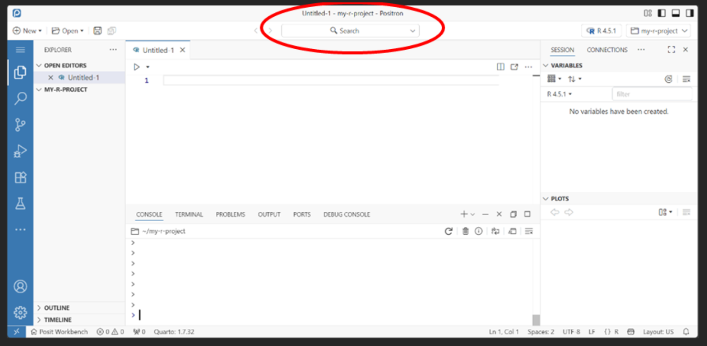
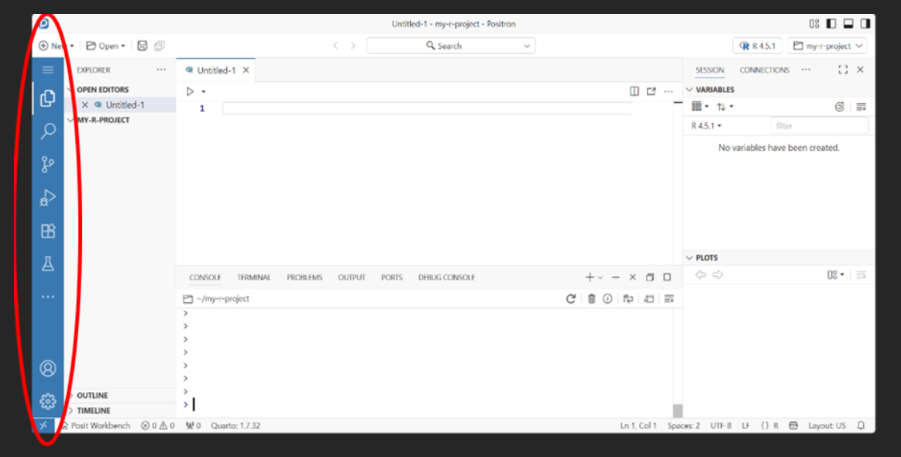

# **2. Where has everything gone?**

-   **Ctrl + Shift + P opens the Command Palette.**

-   The Command Palette lets you search for commands and settings rather
    than having to know where everything is located in Positron!

    
### 
### What are the buttons on the left-hand side?

**The vertical row of icons on the far left of Positron is the Activity
Bar.**

It provides access to tools such as Explorer, Search, Source Control and
Extensions. Selecting an icon changes what is displayed in the Primary
Side Bar next to it.

{width="745"}

### 

### What are Extensions?

**Extensions are add-ons that give Positron extra functionality.**

Positron already includes the core functionality needed for R and Python
data science, but extensions can add support for additional languages,
tools and features. They can be managed from the Extensions tab in the
Activity Bar.

### 

### Where is the Environment pane?

**RStudio: Environment -\> Positron: Variables**

These serve the same basic purpose: they show the objects that exist in
your current R session.

The Variables section appears in the top-right by default, although
Positron's customisable layout means it may be located elsewhere.

### 

### Where is the Files pane?

**RStudio: Files -\> Positron: Explorer**

The Explorer is accessed from the Activity Bar on the left and shows the
files and folders in your current workspace.

### 

### Where is the help pane?

**RStudio: Help -\> Positron: Help**

In Positron, Help appears in the top-right by default alongside Session,
Connections and Viewer.

### 

### Where do plots appear?

**RStudio: Plots -\> Positron: Session -\> Plots**

In Positron, plots appear in the Plots section of the Session pane,
located in the top-right by default.

### 

### Where are packages?

**RStudio: Packages -\> Positron: Packages**

Packages can be managed through the Packages pane, which is opened from
the Activity Bar on the left.

The Packages pane shows packages installed in your active R or Python
session. You can also install, update and uninstall packages from here.

You can still manage R packages from the Console using functions such as
install.packages() and library().

### 

### Where is Git / Source Control?

**RStudio: Git -\> Positron: Source Control**

The Source Control tab is found in the Activity Bar. This is where you
can view changes, stage files, commit changes and work with Git.

### 

### Where is GitHub?

**Git -\> Source Control \| GitHub-specific features -\> GitHub**

If the GitHub extension is installed, the GitHub tab provides additional
functionality such as viewing and managing pull requests. Most
day-to-day Git tasks are performed from Source Control.
