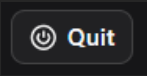
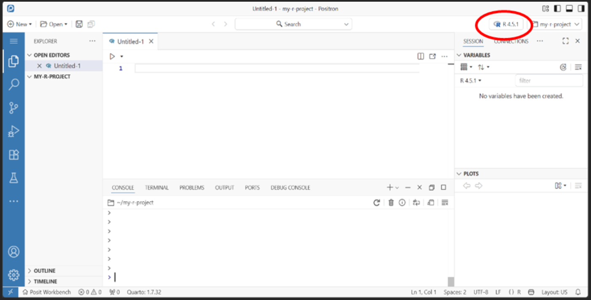

# **3. How do I work with R (and Python) in Positron?**

### How to start using Positron

1.  Log into Posit Workbench

2.  Click New session

3.  Select **Positron Pro** and choose the required CPUs and memory (min
    2.5 GB)

4.  Positron will open in a new Workbench session

5.  Open your project folder by selecting **Open** in the top left

6.  Navigate to the required folder and select it

7.  The folder explorer will appear on the left and any files you open
    will appear in the main editor

### 

### Closing a session

To close a session, click on Positron in the bottom-left corner to
return to the Posit Workbench homepage, tick the box next to your
session and click Quit.

{width="225"}
### 
### Where do I change the R version/interpreter?

**RStudio: R version -\> Positron: Interpreter Selector**

Click the **Interpreter Selector** in the top-right. It displays the
version of R currently in use and allows you to switch to another
installed R version. You can also use it to switch between R and Python,
or start an additional interpreter.

{width="930"}

### 

### How do I restart R?

**Command Palette -\> Interpreter: Restart Active Interpreter Session**

Open the Command Palette (Ctrl + Shift + P) and select Interpreter:
Restart Active Interpreter Session. This restarts the active R
interpreter without restarting Positron or closing your Workbench
session. You can also use Ctrl + Shift + 0.

### 

### How do I inspect a dataframe?

**RStudio: Environment -\> Positron: Session -\> Data**

In Positron, go to Session → Data and select the dataframe you want to
inspect. Positron's Data Explorer also lets you interactively filter and
sort your dataframe, making it easier to investigate your data.

### 

### How do I clear the objects in my R session?

**Restart the active R interpreter: Ctrl + Shift + 0**

Alternatively, open the Command Palette and select Interpreter: Restart
Active Interpreter Session.

Restarting the active R interpreter removes all objects from the session
and provides a clean environment.

### 

### How do I install a package?

**RStudio: Packages -\> Positron: Packages**

Use the Packages pane in the Activity Bar to install and manage
packages.

Alternatively, use install.packages("package_name") from the R Console
as usual.

### 

### If I had a package installed in RStudio, do I need to redownload it in Positron?

**Not necessarily. Packages belong to the R library/environment, rather
than to RStudio or Positron themselves.**

If Positron is using the same R library, previously installed packages
will still be available.
