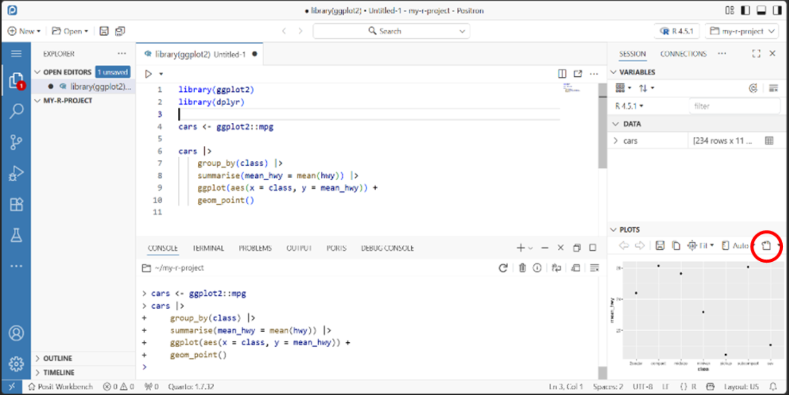

# **5. Other FAQs**

### Why does Positron look like VS Code?

**Positron is built on Code OSS, the same foundation as VS Code, but is
designed specifically for data science.**

Unlike a general-purpose editor such as VS Code, Positron comes ready to
work with R and Python, as well as tools such as Jupyter and Quarto.

### 

### In the scroll bar of the editor what do the different colours mean? E.g. yellow, red...

**Red = errors \| Yellow = warnings**

These are diagnostic markers showing where potential issues occur
throughout the document.
###
### How can I zoom in on a plot like in RStudio with the zoom feature that moves it to another window?

**Plots -\> ... -\> Open Plot in New Window**

From the same menu, you can also open the plot in an editor tab or an
editor tab to the side.

{width="1007"} 
### 
### Where can I see the memory usage pie chart in Positron?

**RStudio: Memory indicator -\> No direct Positron equivalent** 
### 
### How do I close a Positron session from the Positron window in Posit workbench?

**RStudio Pro: Power button -\> Positron Pro: No direct equivalent**

Closing the browser tab/window *does not* terminate the session!

Return to the Posit Workbench home page and exit the session from there.
### 
### How do I insert a new code section?

In Positron the keyboard shortcut from R doesn't work (Ctrl + Shift + R)
unless you have changed the default settings in Positron (see 'Do
RStudio shortcuts still work?' in section 1).

To insert a new code section, use the Command Palette (Ctrl + Shift + P)
and type 'insert new section' and then enter the name of the new section
you want to add. 
### 
### What are renv and venv?

renv (R) and venv (Python) are tools that let each project keep its own
set of packages and package versions. This helps ensure that projects
continue to run as expected and can be more easily shared with others.
