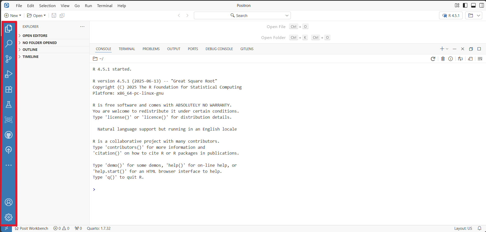
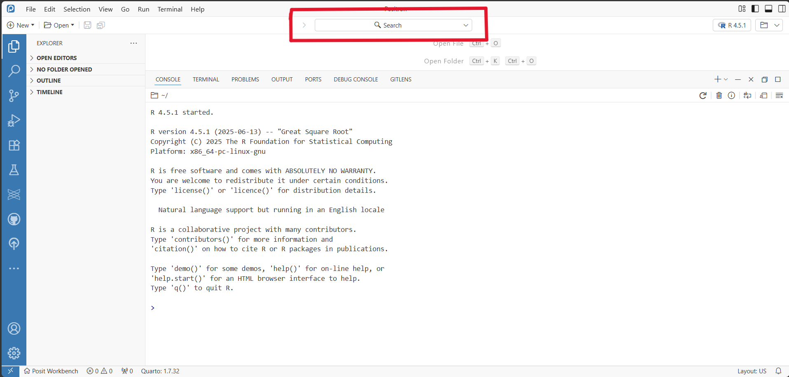
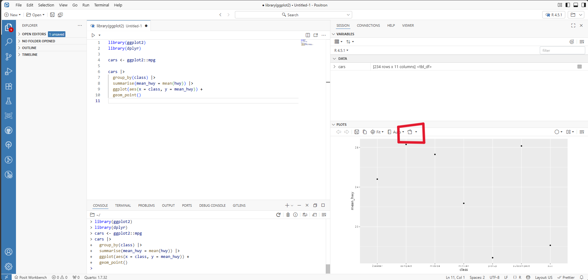
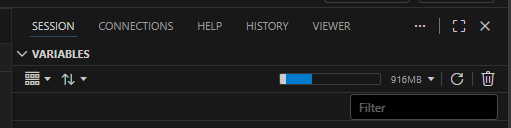
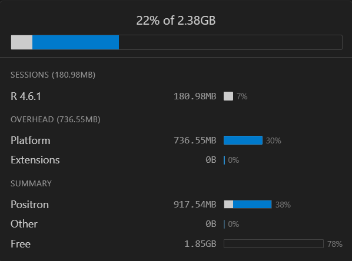

# Navigating Positron

**The vertical row of icons on the far left of Positron is the Activity Bar.**

It provides access to tools such as Explorer, Search, Source Control and [Extensions](#what-are-extensions). Selecting an icon changes what is displayed in the side bar next to it.

The first one, Explorer, shows the files and folders in your current workspace.

**Ctrl + Shift + P opens the Command Palette.** The Command Palette lets you search for commands and settings rather than having to know where everything is located in Positron!

## Where are packages?

The current version of Positron available (`2025.08.1`) doesn't have an equivalent Packages tab to RStudio. You can still manage R packages from the Console using functions such as `install.packages()` and `library()`. There are also extensions available that replicate this functionality (e.g. [Positron R Package Manager](https://open-vsx.org/extension/kv9898/positron-r-package-manager)).

## Where is Git / version control?

**RStudio: Git -\> Positron: Source Control**

The Source Control tab is found in the Activity Bar. This is where you can view changes, stage files, commit changes and work with Git.

## How can I zoom in on a plot like in RStudio with the zoom feature that moves it to another window?

**Plots -\> Open Plot in New Window**

From the same menu, you can also open the plot in an editor tab or an editor tab to the side.

## Where can I see the memory usage pie chart in Positron?

**RStudio: Memory indicator -\> Positron: Memory bar under Variables pane**

You can click on the memory bar to get details on how much memory your session is using and what it is being used for:

Expanded view of memory bar:

## How do I insert a new code section?

In Positron, the keyboard shortcut from R doesn't work (Ctrl + Shift + R) unless you have changed the default settings in Positron.

To insert a new code section, use the Command Palette (Ctrl + Shift + P) and type 'Insert new section' and then enter the name of the new section you want to add.

## In the scroll bar of the editor what do the different colours mean?

**Red = errors \| Yellow = warnings**

These are diagnostic markers showing where potential issues occur throughout the document.

## What are Extensions?

**Extensions are add-ons that give Positron extra functionality.**

Positron already includes the core functionality needed for R, Python and data science, but extensions can add support for additional languages, tools, and features. They can be managed from the Extensions tab in the Activity Bar.

The version of Positron (and VS Code) in PHS Posit Workbench uses the Open VSX marketplace, so availability of extensions may vary from other versions of the application. It is important to keep extensions up to date, as newer versions may include bug fixes, security updates, new features, and compatibility improvements.  For a quick and seamless setup on Posit Workbench, we recommend using the [PHS vscode_prep repository](https://github.com/Public-Health-Scotland/vscode_prep), which provides scripts to install and update a recommended set of extensions for Positron and VS Code.

## Why does Positron look like VS Code?

Positron is built on Code OSS, the same foundation as VS Code, but is designed specifically for data science.

Unlike a general-purpose editor such as VS Code, Positron comes ready to work with R and Python, as well as tools such as Jupyter, Quarto and Shiny.
