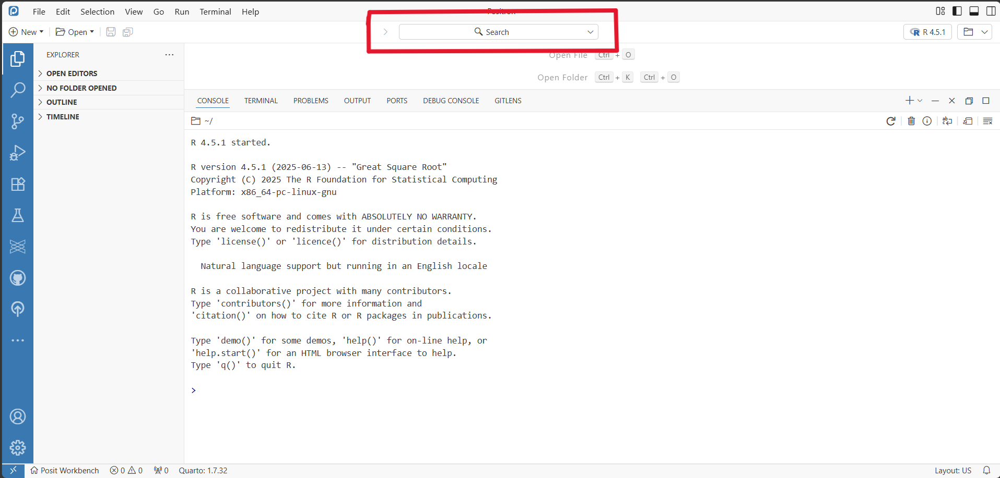

# Positron

**Positron is Posit's next-generation data science IDE. It supports R
and Python as 'first-class' languages and is built on the same
technology as VS Code.**

It allows you to write and run code, explore data, create plots and work
with tools such as Quarto and notebooks within the same application.

It provides interactive features for examining variables, datasets and
plots and further allows users to develop data apps such as Shiny,
Streamlit, or FastAPI, and to publish work directly to Posit Connect and
Posit Connect Cloud.

Compared to RStudio, the IDE is more customisable and more extensions
are provided.

This guide is intended as a quick reference for existing RStudio users
moving to Positron, showing where familiar RStudio features can be found
and highlighting some of the main differences between the two IDEs.

For a more in-depth guide and a hands-on Positron walkthrough, see
[Migrate to Positron from RStudio --
Positron](https://positron.posit.co/tutorial-migrate-from-rstudio)

# Key things to know before you start

-   **Projects are folders** - Positron opens folders directly, rather
    than relying on .Rproj files.

-   **The Command Palette (Ctrl+Shift+P) is your friend** - many actions
    that have menu options in RStudio can also be found here.

-   Positron can open projects created in RStudio, Positron, and
    JupyterLab. If you're using Posit Workbench, **some settings and
    tools can be shared** **between different IDEs**, such as saved
    credentials, installed packages, and GitHub SSH configuration.

